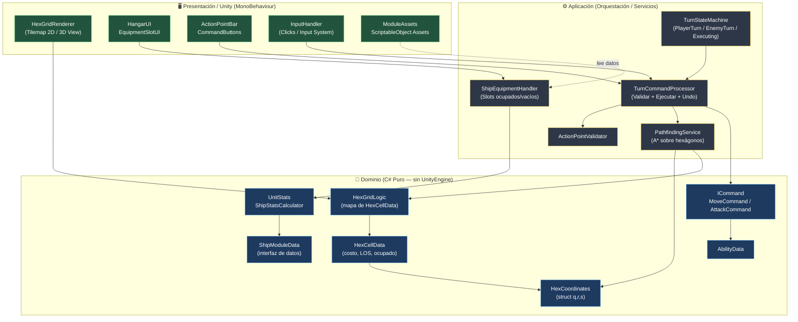
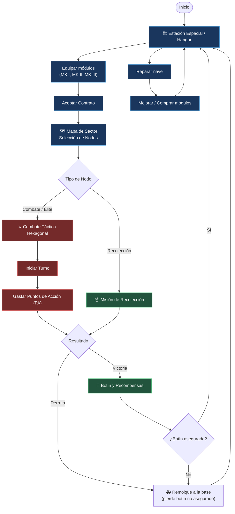
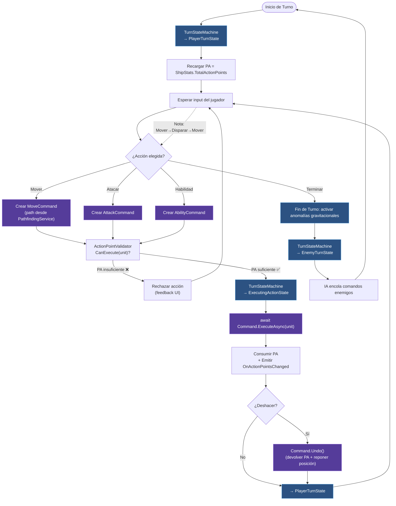
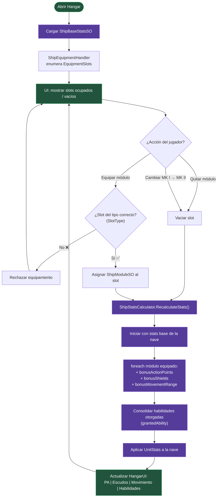
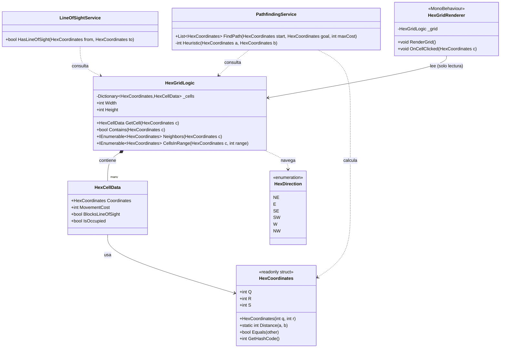
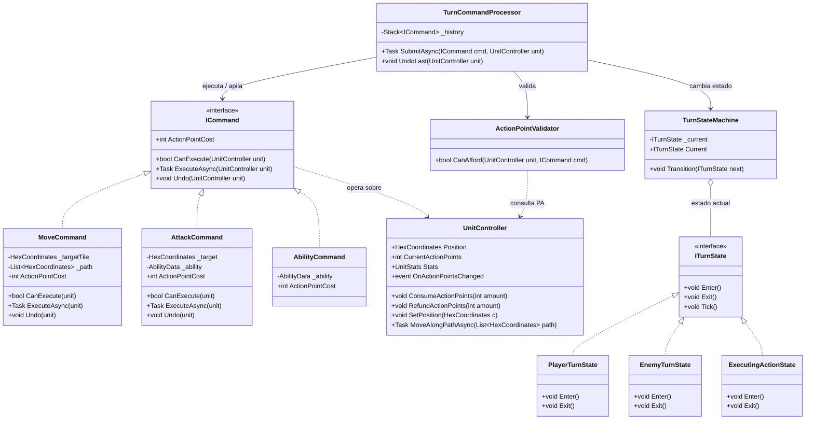
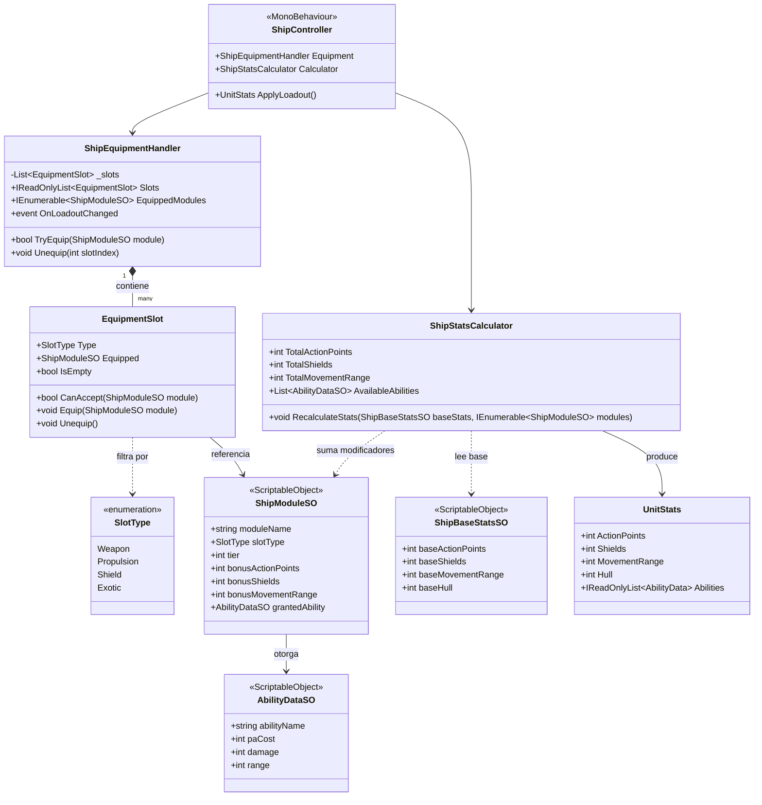
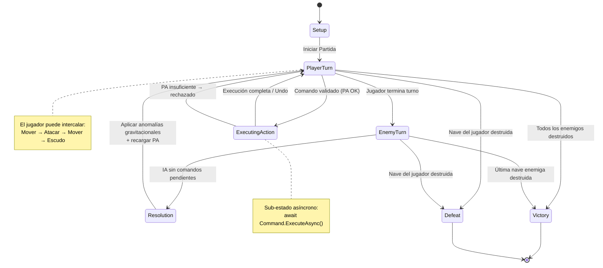
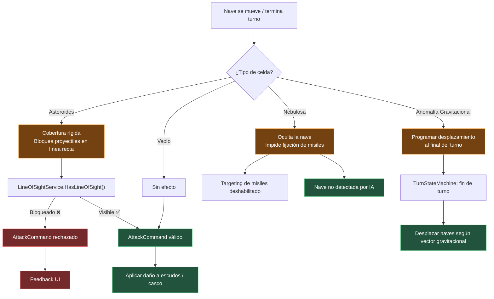

# Void Hex Tactics — Diagramas de Arquitectura

Diagramas de **capas**, **flujo** y **clases** derivados del GDD (TP1: Diseño de Arquitectura en Unity).

---

## 1. Diagrama de Capas (Layered Architecture)

Separación estricta entre **Dominio (C# puro)**, **Aplicación (orquestación)** y **Presentación (Unity)**, con las dependencias apuntando siempre hacia el dominio.



**Regla de dependencia:** `Presentación → Aplicación → Dominio`. El dominio **nunca** referencia `UnityEngine`, por lo que es 100% testeable con NUnit.

---

## 2. Diagrama de Flujo — Core Loop (Bucle Principal)



---

## 3. Diagrama de Flujo — Turno y Ejecución de Comandos Intercalados



---

## 4. Diagrama de Secuencia — Ejecución de `MoveCommand`

```mermaid
sequenceDiagram
    autonumber
    participant UI as InputHandler / UI
    participant APV as ActionPointValidator
    participant PF as PathfindingService
    participant TCP as TurnCommandProcessor
    participant SB as StateMachine
    participant CMD as MoveCommand
    participant U as UnitController
    participant BAR as ActionPointBar (UI)

    UI->>PF: RequestPath(origin, target, grid)
    PF-->>UI: List<HexCoordinates> path
    UI->>CMD: new MoveCommand(target, path, costPerTile)
    UI->>TCP: Submit(CMD)
    TCP->>APV: CanExecute(unit)
    APV-->>TCP: true (PA suficientes)
    TCP->>SB: Transition(ExecutingActionState)
    TCP->>CMD: await ExecuteAsync(unit)
    CMD->>U: ConsumeActionPoints(cost)
    U-->>BAR: OnActionPointsChanged(cost) [evento C#]
    CMD->>U: await MoveAlongPathAsync(path)
    U-->>CMD: (animación finalizada)
    CMD-->>TCP: completed
    TCP->>SB: Transition(PlayerTurnState)
    Note over UI,BAR: UI nunca consulta al modelo por frame;<br/>reacciona al evento OnActionPointsChanged
```

---

## 5. Diagrama de Flujo — Cálculo de Estadísticas al Equipar (Problema 3)



---

## 6. Diagrama de Clases — Problema 1 (Grilla Hexagonal)



---

## 7. Diagrama de Clases — Problema 2 (Comandos, Turnos y PA)



---

## 8. Diagrama de Clases — Problema 3 (Módulos y Estadísticas)



---

## 9. Diagrama de Estados — Máquina de Turnos



---

## 10. Diagrama de Flujo — Entorno Táctico Interactivo



---

## Leyenda de Capas

| Capa | Responsabilidad | Depende de | Testeable sin Unity |
| --- | --- | --- | --- |
| **Presentación** (`MonoBehaviour`, UI, Tilemap) | Render, input, animación | Aplicación + Dominio | ❌ No |
| **Aplicación** (Servicios, FSM, Processor) | Orquestar, validar, ejecutar, deshacer | Dominio | ⚠️ Parcial |
| **Dominio** (structs, lógica pura, interfaces) | Reglas de negocio, matemática | *Nada externo* | ✅ Sí (NUnit) |

> **Principio rector:** todas las flechas de dependencia apuntan hacia el **Dominio**. Esto garantiza que la grilla hexagonal, el patrón comando y el cálculo de estadísticas sean independientes del motor gráfico, cumpliendo con SRP, OCP y facilitando los Unit Tests.
