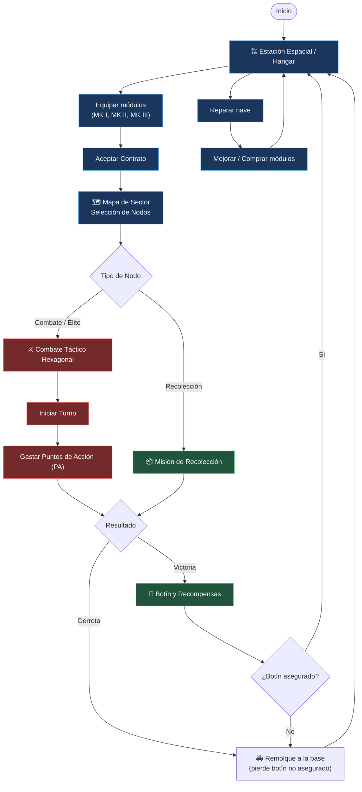
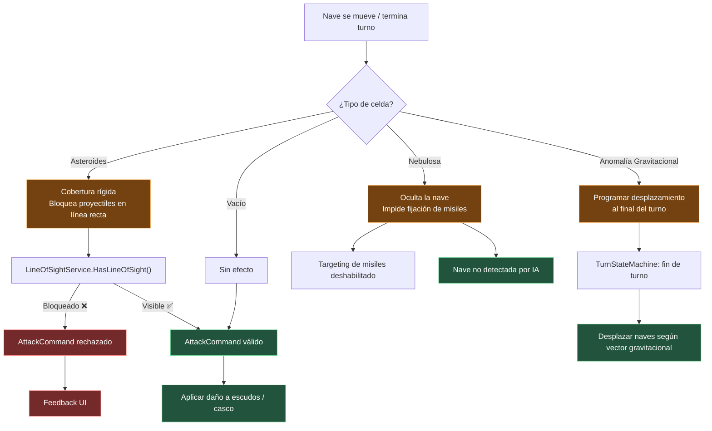
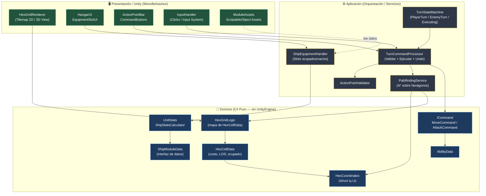
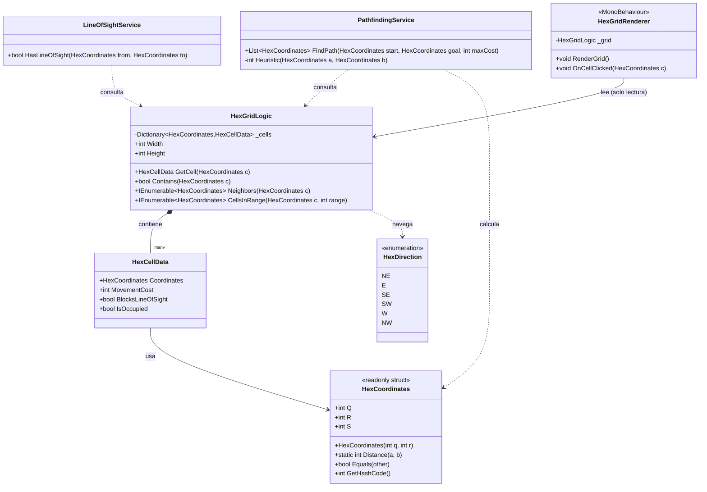
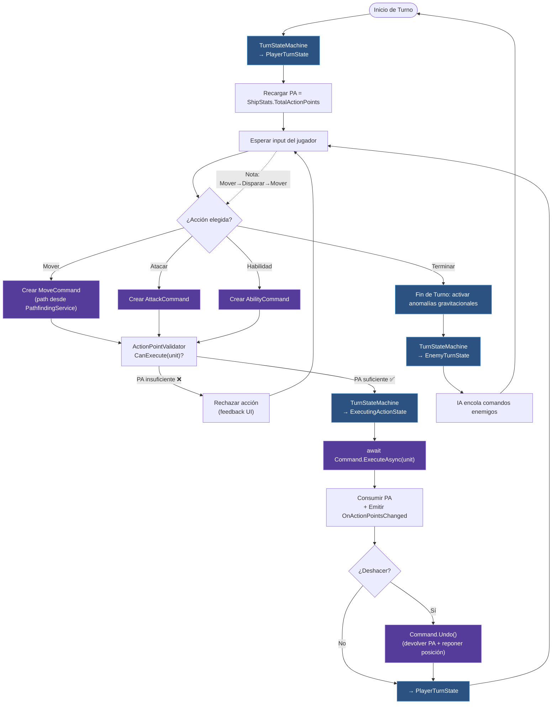
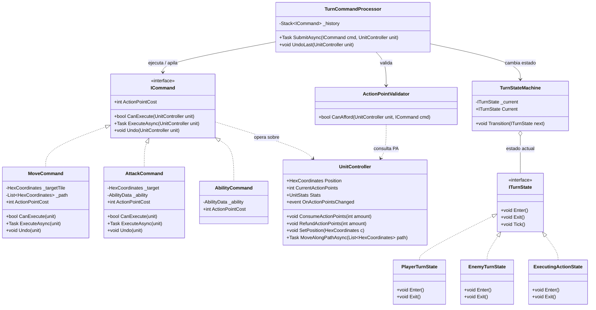
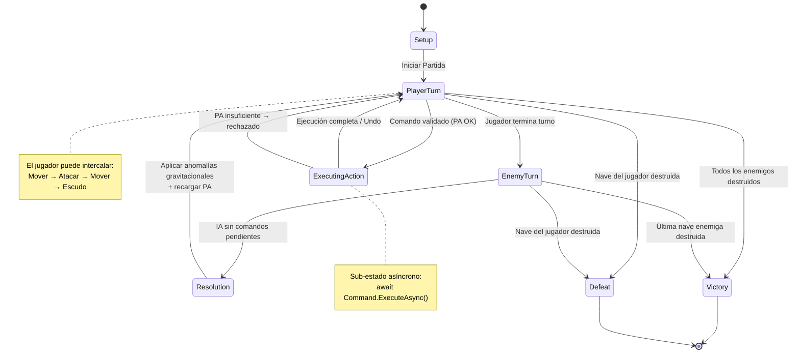
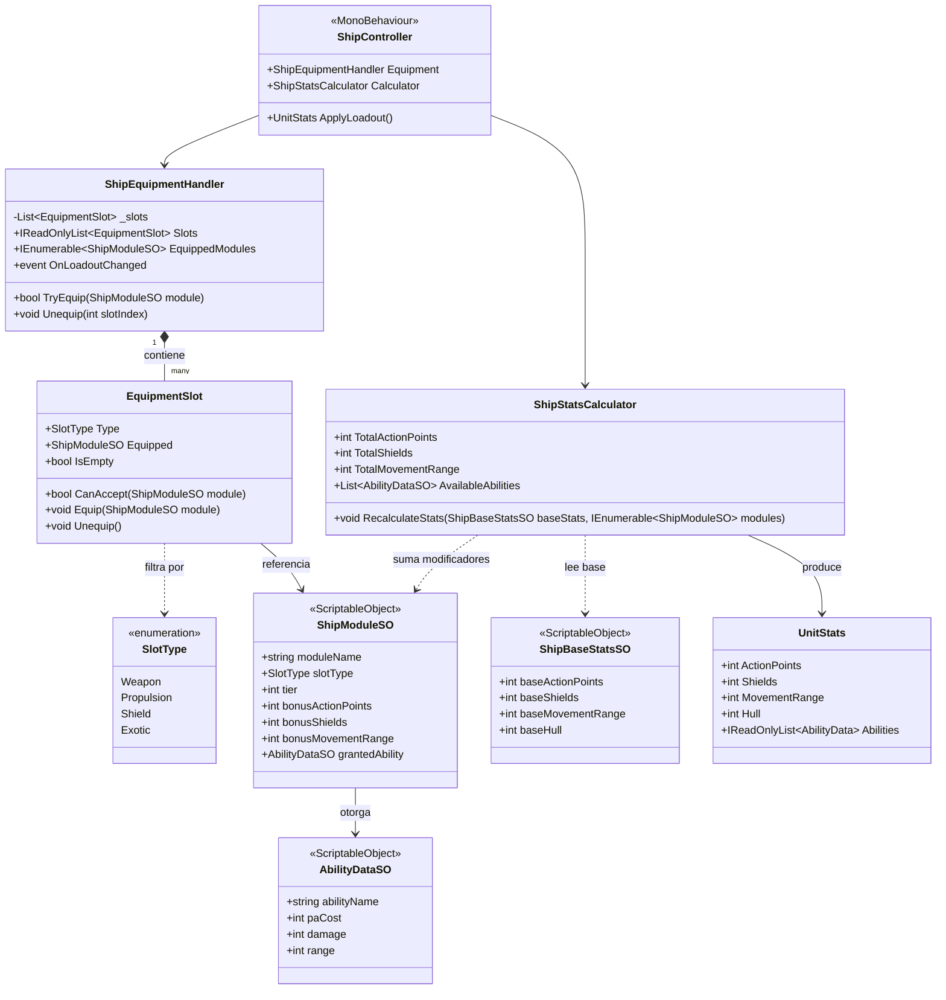
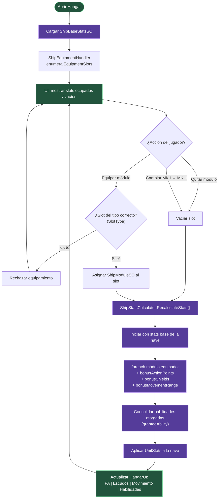

Este borrador de documento cumple con todos los requerimientos especificados para el **Trabajo Práctico 1: Diseño de Arquitectura en Unity**.

Está estructurado para ser presentado como informe (PDF / Markdown / Slides) y defensible en la presentación oral.

---

# TP1: Diseño de Arquitectura en Unity

**Proyecto:** *Void Hex Tactics* (Nombre preliminar)

**Materia:** Diseño de Arquitectura en Unity

**Integrantes:** 1

**Docente:** Diego Freijo

**Fecha de Entrega:** 23/09

---

### Índice de Diagramas

Los diagramas de arquitectura (capas, flujo, clases, secuencia y estados) se incluyen **embebidos** en cada sección y se encuentran también completos en el anexo **[`DIAGRAMS.md`](./DIAGRAMS.md)**.

| # | Diagrama | Tipo | Sección del GDD |
| --- | --- | --- | --- |
| 1 | Arquitectura en Capas (Presentación / Aplicación / Dominio) | Capas | [4.2](#42-definición-de-problemas--funcionalidades-técnicas) |
| 2 | Core Loop (bucle principal) | Flujo | [4.1](#41-definición-del-juego) |
| 3 | Turno y comandos intercalados | Flujo | [Problema 2](#431-problema-2-flujo-de-turnos-economía-de-puntos-de-acción-y-patrón-comando) |
| 4 | Ejecución de `MoveCommand` | Secuencia | [Problema 2](#431-problema-2-flujo-de-turnos-economía-de-puntos-de-acción-y-patrón-comando) |
| 5 | Equipamiento y recálculo de estadísticas | Flujo | [Problema 3](#431-problema-3-sistema-de-slots-de-equipamiento-módulos-y-estadísticas) |
| 6 | Grilla hexagonal y pathfinding | Clases | [Problema 1](#431-problema-1-matemática-de-la-grilla-hexagonal-y-pathfinding) |
| 7 | Comandos, turnos y PA | Clases | [Problema 2](#431-problema-2-flujo-de-turnos-economía-de-puntos-de-acción-y-patrón-comando) |
| 8 | Módulos y estadísticas | Clases | [Problema 3](#431-problema-3-sistema-de-slots-de-equipamiento-módulos-y-estadísticas) |
| 9 | Máquina de estados de turnos | Estados | [Problema 2](#431-problema-2-flujo-de-turnos-economía-de-puntos-de-acción-y-patrón-comando) |
| 10 | Entorno táctico interactivo (asteroides / nebulosas / anomalías) | Flujo | [4.1](#41-definición-del-juego) |

---

## 4.1. Definición del Juego

### Contexto y Concepto General

*Void Hex Tactics* es un juego de **combate espacial táctico por turnos en cuadrícula hexagonal 2D/3D**. El jugador controla una nave personalizada que acepta contratos de combate y exploración en sectores estelares.

A diferencia de un *roguelike*, la estructura se basa en un **Tactics RPG con farmeo y progresión continua** (similar a la estructura de misiones de *Front Mission* o *Battletech*, pero con combate espacial en grilla). Si el jugador es derrotado, es remolcado a la base más cercana perdiendo únicamente el botín no asegurado de la misión, manteniendo el progreso de su nave.

### Bucle Principal de Juego (Core Loop)

```
[ Estación Espacial / Hangar ] 
             │ (Aceptar Contratos / Equipar Módulos MK I, MK II, etc.)
             ▼
[ Mapa de Sector / Selección de Nodos ]
             │ (Elegir misión de combate, recolección o élite)
             ▼
[ Combate Táctico Hexagonal ] 
             │ (Gastar Puntos de Acción para mover, atacar y usar el entorno)
             ▼
[ Botín y Recompensas ] ──► (Regreso al Hangar para reparar y mejorar)

```

#### Diagrama de Flujo — Core Loop



> **[Ver versión completa en `DIAGRAMS.md` §2](./DIAGRAMS.md)**

### Mecánicas Clave de Combate

1. **Economía de Puntos de Acción (PA) Flexible:** La nave dispone de un pozo de PA por turno. El jugador puede distribuir sus PA libremente intercalando acciones (ejemplo: Mover 2 casillas $\rightarrow$ Disparar cañón $\rightarrow$ Mover 1 casilla $\rightarrow$ Activar escudo).
2. **Entorno Táctico Interactivo:** El tablero no es neutro.
* *Campos de Asteroides:* Actúan como cobertura rígida y bloquean proyectiles en línea recta.
* *Nebulosas:* Ocultan la nave e impiden la fijación de misiles.
* *Anomalías Gravitacionales:* Desplazan naves al final del turno.


3. **Equipamiento Modular:** La nave posee ranuras (*slots*) de componentes (Armamento, Propulsión, Escudos, Módulos Exóticos) equipables con versiones progresivas (MK I, MK II, MK III).

#### Diagrama de Flujo — Entorno Táctico Interactivo



> **[Ver versión completa en `DIAGRAMS.md` §10](./DIAGRAMS.md)**

---

## 4.2. Definición de Problemas / Funcionalidades Técnicas

Para asegurar una arquitectura mantenible, escalable y testeable, se seleccionaron los siguientes **3 problemas técnicos fundamentales**:

1. **Problema 1: Matmática de la Grilla Hexagonal y Pathfinding con Costo de Movimiento variable.**
*Justificación:* El movimiento en 6 direcciones y la distancia en coordenadas no ortogonales requieren una representación matemática eficiente para cálculo de rangos, líneas de visión (LOS) y rutas de movimiento basadas en PA.
2. **Problema 2: Flujo de Turnos, Economía de Puntos de Acción y Ejecución de Comandos Intercalados.**
*Justificación:* La libertad de mover, atacar y volver a mover en cualquier orden exige desacoplar las acciones de la interfaz de usuario y del motor de física, permitiendo validar, ejecutar y eventualmente deshacer movimientos.
3. **Problema 3: Sistema de Slots de Equipamiento, Módulos (MK I / MK II) y Modificadores de Estadísticas.**
*Justificación:* Al equipar o cambiar módulos en el Hangar, la nave debe recalcular dinámicamente sus estadísticas (PA, salud, escudos, velocidad) y actualizar sus habilidades de ataque sin acoplar código duro por cada tipo de arma.

---

### Diagrama de Capas — Vista Global de la Arquitectura

Separación estricta entre **Dominio (C# puro)**, **Aplicación (orquestación)** y **Presentación (Unity)**, con todas las dependencias apuntando hacia el dominio.



**Regla de dependencia:** `Presentación → Aplicación → Dominio`. El dominio **nunca** referencia `UnityEngine`, por lo que es 100% testeable con NUnit.

| Capa | Responsabilidad | Depende de | Testeable sin Unity |
| --- | --- | --- | --- |
| **Presentación** (`MonoBehaviour`, UI, Tilemap) | Render, input, animación | Aplicación + Dominio | ❌ No |
| **Aplicación** (Servicios, FSM, Processor) | Orquestar, validar, ejecutar, deshacer | Dominio | ⚠️ Parcial |
| **Dominio** (structs, lógica pura, interfaces) | Reglas de negocio, matemática | *Nada externo* | ✅ Sí (NUnit) |

> **[Ver versión completa en `DIAGRAMS.md` §1](./DIAGRAMS.md)**

---

## 4.3. Soluciones Técnicas

---

### 4.3.1. Problema 1: Matemática de la Grilla Hexagonal y Pathfinding

#### Planteo de Soluciones Alternativas

* **Solución A: Monobehaviours por Casilla (HexTile GameObjects)**
* *Descripción:* Cada celda de la grilla es un `GameObject` con un componente `HexTile : MonoBehaviour` y *colliders*. Mantiene referencias directas a sus 6 vecinos mediante `List<HexTile>` asignadas en la escena o mediante `Raycasts`.
* *Ventajas:* Fácil de visualizar e interactuar en el editor mediante clics directos (`OnMouseDown`).
* *Desventajas:* Altísimo consumo de memoria, acoplamiento total a Unity, dificultad para realizar búsquedas lógicas en segundo plano (Pathfinding lento por `GetComponent` / llamadas de física) e imposible de testear mediante Unit Tests sin instanciar la escena.


* **Solución B: Matriz 2D Tradicional `Tile[x,y]` con Desplazamiento Visual (Offset Coordinates)**
* *Descripción:* Utilizar una matriz bidimensional convencional de datos y adaptar las coordenadas mediante código para desplazar visualmente las filas impares.
* *Ventajas:* Estructura de datos simple y conocida.
* *Desventajas:* La matemática para calcular distancias reales en línea recta o arcos de disparo en hexágonos se vuelve sumamente compleja y propensa a errores, ya que las distancias cambian dependiendo de si la fila es par o impar.


* **Solución C (SELECCIONADA): Sistema de Coordenadas Cúbicas ($q, r, s$) desacoplado en C# Puro + Tilemap/View en Unity**
* *Descripción:* Representar la grilla internamente usando **Coordenadas Cúbicas Axial-Cúbicas** donde $q + r + s = 0$. Trazar la lógica de pathfinding (A*) y cálculos de distancia en estructuras C# puras (`struct HexCoordinates`), separando la lógica del renderizado visual (Unity `Tilemap` 2D o renderizado 3D via *Data Binding*).


#### Comparativa y Selección

| Criterio | Solución A (MonoBehaviours) | Solución B (Matriz 2D Offset) | Solución C (Coordenadas Cúbicas C#) |
| --- | --- | --- | --- |
| **Complejidad Matemática** | Alta (física / raycasts) | Muy Alta (casos borde par/impar) | **Baja y Elegante** ($q+r+s=0$) |
| **Performance** | Mala (overhead de GameObjects) | Buena | **Excelente** (estructuras `struct` sin alloc) |
| **Desacoplamiento / Testeabilidad** | Nula | Media | **Total** (100% ejecutable en NUnit) |

**Elección:** Se elige la **Solución C**. La coordenada cúbica es el estándar de la industria para juegos hexagonales tácticos porque convierte el cálculo de distancia entre dos celdas $A$ y $B$ en una fórmula trivial:


$$\text{Distancia} = \frac{\vert{}q_1 - q_2\vert{} + \vert{}r_1 - r_2\vert{} + \vert{}s_1 - s_2\vert{}}{2}$$

---

#### 4.3.2. Explicación en Profundidad (Problema 1)

##### Estructura de Coordenadas y Lógica de Grilla (C# Puro)

```csharp
using System;
using System.Collections.Generic;

// Estructura inmutable para evitar asignaciones en GC (Garbage Collector)
public readonly struct HexCoordinates : IEquatable<HexCoordinates>
{
    public readonly int Q; // Eje X
    public readonly int R; // Eje Z
    public readonly int S; // Eje Y (Q + R + S = 0)

    public HexCoordinates(int q, int r)
    {
        Q = q;
        R = r;
        S = -q - r;
    }

    public static int Distance(HexCoordinates a, HexCoordinates b)
    {
        return (Math.Abs(a.Q - b.Q) + Math.Abs(a.R - b.R) + Math.Abs(a.S - b.S)) / 2;
    }

    public bool Equals(HexCoordinates other) => Q == other.Q && R == other.R && S == other.S;
    public override bool Equals(object obj) => obj is HexCoordinates other && Equals(other);
    public override int GetHashCode() => HashCode.Combine(Q, R, S);
}

// Celda lógica que no hereda de MonoBehaviour
public class HexCellData
{
    public HexCoordinates Coordinates { get; }
    public int MovementCost { get; set; } = 1;
    public bool BlocksLineOfSight { get; set; } = false;
    public bool IsOccupied { get; set; } = false;

    public HexCellData(HexCoordinates coordinates)
    {
        Coordinates = coordinates;
    }
}

```

##### Arquitectura y Principios SOLID

* **Single Responsibility Principle (SRP):** `HexCoordinates` solo gestiona matemática de espacio; `HexGridGridLogic` gestiona el mapa de celdas; un componente visual separado (`HexGridRenderer : MonoBehaviour`) lee `HexGridGridLogic` para mover las representaciones gráficas en pantalla.
* **Testeabilidad:** Se pueden escribir pruebas unitarias automatizadas (*Unit Tests*) en Unity Test Runner para validar que el Pathfinding evite asteroides o respete los Puntos de Acción (PA) sin necesidad de cargar elementos gráficos ni escenas.

##### Diagrama de Clases — Grilla Hexagonal (Problema 1)



> **[Ver versión completa en `DIAGRAMS.md` §6](./DIAGRAMS.md)**

---

### 4.3.1. Problema 2: Flujo de Turnos, Economía de Puntos de Acción y Patrón Comando

#### Planteo de Soluciones Alternativas

* **Solución A: Controlador Monolítico con Corrutinas (`TurnGameManager`)**
* *Descripción:* Un script centralizado en Unity que controla todo con variables booleanas (`isPlayerTurn`, `canAttack`, `isMoving`) y corrutinas (`IEnumerator`) para esperar el final de las animaciones.
* *Ventajas:* Rápido de implementar en prototipos iniciales.
* *Desventajas:* Spaghetti code inaccesible. Agregar nuevas acciones (ej. usar un módulo exótico de Rayo Tractor) obliga a modificar todo el GameManager. Dificultad para deshacer acciones o encolar acciones de la IA.


* **Solución B (SELECCIONADA): Máquina de Estados Finita (FSM) + Patrón Comando (`ICommand`)**
* *Descripción:* El turno se divide en estados claros (`PlayerTurnState`, `EnemyTurnState`, `ExecutingActionState`). Cada acción en el tablero (Moverse a un hexágono, Atacar objetivo, Disparar habilidad) se encapsula en un objeto comando que implementa una interfaz `ICommand`.
* *Ventajas:*
* La UI solo solicita la creación de un `Command` y se lo envía al procesador.
* Altamente desacoplado: se pueden validar PA de manera previa antes de ejecutar la acción.
* Soporta la funcionalidad de "Deshacer movimiento" (*Undo*) restando/sumando los PA gastados.


* *Desventajas:* Requiere escribir más clases pequeñas al inicio del desarrollo.


#### Comparativa y Selección

**Elección:** Se elige la **Solución B**. La arquitectura basada en el **Patrón Comando** encaja perfectamente con el requerimiento del juego donde el personaje gasta Puntos de Acción (PA) de manera intercalada en cualquier orden.

---

#### 4.3.2. Explicación en Profundidad (Problema 2)

##### Implementación del Patrón Comando (C#)

```csharp
using System.Threading.Tasks;

public interface ICommand
{
    int ActionPointCost { get; }
    bool CanExecute(UnitController unit);
    Task ExecuteAsync(UnitController unit); // Task asincrónico para integrar animaciones sin bloquear el hilo principal
    void Undo(UnitController unit);
}

public class MoveCommand : ICommand
{
    private readonly HexCoordinates _targetTile;
    private readonly List<HexCoordinates> _path;
    public int ActionPointCost { get; }

    public MoveCommand(HexCoordinates targetTile, List<HexCoordinates> path, int costPerTile)
    {
        _targetTile = targetTile;
        _path = path;
        ActionPointCost = path.Count * costPerTile;
    }

    public bool CanExecute(UnitController unit)
    {
        return unit.CurrentActionPoints >= ActionPointCost;
    }

    public async Task ExecuteAsync(UnitController unit)
    {
        unit.ConsumeActionPoints(ActionPointCost);
        // La animación de movimiento se ejecuta de forma asíncrona
        await unit.MoveAlongPathAsync(_path); 
    }

    public void Undo(UnitController unit)
    {
        unit.RefundActionPoints(ActionPointCost);
        unit.SetPosition(_path[0]); // Regresa al origen
    }
}

```

##### Flujo de Gestión de Dependencias

```
 [ UI / Input Handler ] ──(Pide validación)──► [ ActionPointValidator ]
           │                                          │
    (Crea Command)                             (Aprueba PA)
           │                                          │
           ▼                                          ▼
 [ TurnCommandProcessor ] ───(Ejecuta Async)───► [ UnitController ]
           │
  (Emite C# Event) ──► [ UI ActionPointBar ] (Actualiza barra de energía)

```

* **Desacoplamiento:** El `ActionPointBar` (UI) no consulta en cada frame al jugador. Se suscribe a los eventos del `UnitController` (`OnActionPointsChanged`).
* **Open/Closed Principle (SOLID):** Si en el futuro se añade una habilidad de teletransporte o un rayo de energía, solo se crea una clase `TeleportCommand : ICommand` sin alterar la Máquina de Estados ni la UI.

##### Diagrama de Flujo — Turno y Comandos Intercalados



##### Diagrama de Secuencia — Ejecución de `MoveCommand`

```mermaid
sequenceDiagram
    autonumber
    participant UI as InputHandler / UI
    participant APV as ActionPointValidator
    participant PF as PathfindingService
    participant TCP as TurnCommandProcessor
    participant SB as StateMachine
    participant CMD as MoveCommand
    participant U as UnitController
    participant BAR as ActionPointBar (UI)

    UI->>PF: RequestPath(origin, target, grid)
    PF-->>UI: List<HexCoordinates> path
    UI->>CMD: new MoveCommand(target, path, costPerTile)
    UI->>TCP: Submit(CMD)
    TCP->>APV: CanExecute(unit)
    APV-->>TCP: true (PA suficientes)
    TCP->>SB: Transition(ExecutingActionState)
    TCP->>CMD: await ExecuteAsync(unit)
    CMD->>U: ConsumeActionPoints(cost)
    U-->>BAR: OnActionPointsChanged(cost) [evento C#]
    CMD->>U: await MoveAlongPathAsync(path)
    U-->>CMD: (animación finalizada)
    CMD-->>TCP: completed
    TCP->>SB: Transition(PlayerTurnState)
    Note over UI,BAR: UI nunca consulta al modelo por frame;<br/>reacciona al evento OnActionPointsChanged
```

##### Diagrama de Clases — Comandos, Turnos y PA (Problema 2)



##### Diagrama de Estados — Máquina de Turnos



> **[Ver versiones completas en `DIAGRAMS.md` §3, §4, §7 y §9](./DIAGRAMS.md)**

---

### 4.3.1. Problema 3: Sistema de Slots de Equipamiento, Módulos y Estadísticas

#### Planteo de Soluciones Alternativas

* **Solución A: Herencia de Clases de Naves y Módulos**
* *Descripción:* Crear clases derivadas para cada combinación: `WeaponModule`, `LaserMK1Module : WeaponModule`, `ShieldMK1Module`.
* *Ventajas:* Polimorfismo tradicional directo.
* *Desventajas:* Explosión de clases en el proyecto. Cambiar los valores numéricos de un cañón MK I a MK II requiere tocar código o compilar nuevas variantes.


* **Solución B (SELECCIONADA): Sistema Data-Driven mediante `ScriptableObjects` + Modificadores por Composición**
* *Descripción:* Los módulos son contenedores de datos (`ShipModuleSO : ScriptableObject`). La nave posee una lista de slots configurables (`List<EquipmentSlot>`). Un calculador de estadísticas consolida las estadísticas base de la nave sumando o multiplicando los modificadores provistos por los módulos equipados.


#### Comparativa y Selección

**Elección:** Se elige la **Solución B**. Es el patrón recomendado en Unity para sistemas de equipamiento e inventario. Permite al diseñador crear variantes de módulos (Módulos MK I, MK II, MK III) desde la interfaz de Unity sin tocar una sola línea de C#.

---

#### 4.3.2. Explicación en Profundidad (Problema 3)

##### Definición de Datos con ScriptableObject (C#)

```csharp
using UnityEngine;
using System.Collections.Generic;

public enum SlotType { Weapon, Propulsion, Shield, Exotic }

[CreateAssetMenu(fileName = "NewModule", menuName = "Ship/Module")]
public class ShipModuleSO : ScriptableObject
{
    public string moduleName;
    public SlotType slotType;
    public int tier; // MK I = 1, MK II = 2, etc.

    [Header("Stat Modifiers")]
    public int bonusActionPoints;
    public int bonusShields;
    public int bonusMovementRange;

    [Header("Grants Ability")]
    public AbilityDataSO grantedAbility; // Opcional: añade un tipo de ataque al ser equipado
}

// Calculador de Estadísticas Consolidadas
public class ShipStatsCalculator
{
    public int TotalActionPoints { get; private set; }
    public int TotalShields { get; private set; }

    public void RecalculateStats(ShipBaseStatsSO baseStats, IEnumerable<ShipModuleSO> equippedModules)
    {
        TotalActionPoints = baseStats.baseActionPoints;
        TotalShields = baseStats.baseShields;

        foreach (var module in equippedModules)
        {
            if (module == null) continue;
            TotalActionPoints += module.bonusActionPoints;
            TotalShields += module.bonusShields;
        }
    }
}

```

##### Beneficios Arquitectónicos

* **Gestión de Memoria y Performance:** Los `ScriptableObjects` actúan como *Flyweight Pattern*. Múltiples naves enemigas utilizando el mismo "Escudo MK I" leen el mismo objeto de datos en RAM sin duplicar información.
* **Separación de Responsabilidades (SRP):**
* `ShipModuleSO`: Solo almacena datos de los módulos.
* `ShipStatsCalculator`: Solo procesa las matemáticas de consolidación de estadísticas.
* `ShipEquipmentHandler`: Administra los slots vacíos/ocupados en la nave.

##### Diagrama de Clases — Módulos y Estadísticas (Problema 3)



##### Diagrama de Flujo — Recálculo de Estadísticas al Equipar



> **[Ver versiones completas en `DIAGRAMS.md` §5 y §8](./DIAGRAMS.md)**


---

## Resumen de Decisiones de Arquitectura

1. **Grilla Hexagonal:** Implementada mediante C# puro utilizando **Coordenadas Cúbicas ($q,r,s$)**, desacoplada de los componentes visuales de Unity para maximizar performance y permitir pruebas unitarias con NUnit.
2. **Sistema de Acciones:** Diseñado con el **Patrón Comando (`ICommand`)** integrado a una **Máquina de Estados Finita**, permitiendo al jugador gastar sus Puntos de Acción (PA) de forma libre e intercalada.
3. **Módulos y Progresión (MK I / MK II):** Arquitectura *Data-Driven* con **ScriptableObjects** y composición de estadísticas, facilitando la adición de nuevo contenido sin refactorización de código.

---

### Anexo: Diagramas de Arquitectura

Todos los diagramas (capas, flujo, clases, secuencia y estados) están disponibles de forma consolidada en **[`DIAGRAMS.md`](./DIAGRAMS.md)**:

1. **Capas:** Presentación → Aplicación → Dominio.
2. **Core Loop:** hangar → sector → combate → botín.
3. **Turno y comandos intercalados:** validación de PA y Undo.
4. **Secuencia:** ejecución de `MoveCommand` y evento `OnActionPointsChanged`.
5. **Equipamiento:** recálculo de estadísticas al equipar módulos.
6. **Clases:** grilla hexagonal (`HexCoordinates`, `HexGridLogic`, `PathfindingService`).
7. **Clases:** comandos, turnos y PA (`ICommand`, `TurnCommandProcessor`, FSM).
8. **Clases:** módulos y estadísticas (`ShipModuleSO`, `EquipmentSlot`, `ShipStatsCalculator`).
9. **Estados:** máquina de turnos y condiciones de victoria/derrota.
10. **Flujo:** entorno táctico (asteroides, nebulosas, anomalías gravitacionales).

---

### Recomendaciones para la Defensa Oral (30/09)

* **Demostrar Desacoplamiento:** Explicar cómo la lógica central del combate ($q,r,s$, comandos y calculador de stats) puede ejecutarse sin la necesidad de abrir el motor gráfico de Unity.
* **Manejar Justificaciones:** Enfatizar que la elección de C# puro para la grilla y ScriptableObjects para los módulos evita la sobrecarga de `MonoBehaviours` innecesarios en la escena.
* **Usar los Diagramas como Guion:** Recorrer el **diagrama de capas** para justificar la regla de dependencia, el **diagrama de secuencia** (`MoveCommand`) para explicar el desacoplamiento UI ↔ lógica, y el **diagrama de estados** para mostrar cómo se intercalan las acciones dentro de un mismo turno. Ver [`DIAGRAMS.md`](./DIAGRAMS.md).