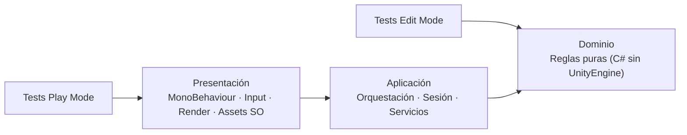

# 01 — Arquitectura: reglas, capas y estructura

## 1. Regla de dependencia



| Capa | Responsabilidad | Puede depender de | Testeable sin escena |
| --- | --- | --- | --- |
| **Dominio** | Reglas, matemática, invariantes, validaciones | Nada externo | Sí (NUnit, Edit Mode) |
| **Aplicación** | Orquestar casos de uso, mantener estado de sesión | Dominio | Sí (Edit Mode) |
| **Presentación** | Input, render, animación, assets de Unity | Aplicación + Dominio | Solo con Play Mode |

**Regla dura:** ninguna referencia va "hacia arriba". El dominio no sabe que existe Unity, ni
que existe una UI, ni que existe una escena.

## 2. Cómo se hace cumplir (asmdef)

Cada prototipo tiene tres assemblies como mínimo. P2 agrega `…Application` (orquestación pura)
porque tiene un caso de uso con estado; P1 y P3 no lo necesitan.

| Assembly | `noEngineReferences` | Referencias | Contenido |
| --- | --- | --- | --- |
| `VoidHex.Pn.Domain` | `true` | — | Coordenadas, reglas, resultados, cálculo puro |
| `VoidHex.Pn.Application` | `true` | `…Domain` | Solo P2: `TurnSession` (validar → aplicar → historial) |
| `VoidHex.Pn.Unity` | `false` | `…Domain`, `…Application` (si existe) | MonoBehaviours, escena, adaptadores SO |
| `VoidHex.Pn.Tests.EditMode` | `false` | `…Domain`, `…Application`, `UnityEngine.TestRunner`, `UnityEditor.TestRunner` | Tests de dominio, aplicación y adaptadores |
| `VoidHex.Pn.Tests.PlayMode` | `false` | `…Unity`, `…Domain`, `…Application`, test runners | Solo P2 (ciclo de vida) |

Ejemplo de dominio puro:

```json
{
  "name": "VoidHex.P1.Domain",
  "rootNamespace": "VoidHex.P1.Domain",
  "references": [],
  "includePlatforms": [],
  "excludePlatforms": [],
  "allowUnsafeCode": false,
  "overrideReferences": false,
  "precompiledReferences": [],
  "autoReferenced": false,
  "defineConstraints": [],
  "versionDefines": [],
  "noEngineReferences": true
}
```

Ejemplo de tests:

```json
{
  "name": "VoidHex.P1.Tests.EditMode",
  "rootNamespace": "VoidHex.P1.Tests",
  "references": ["VoidHex.P1.Domain", "UnityEngine.TestRunner", "UnityEditor.TestRunner"],
  "includePlatforms": ["Editor"],
  "precompiledReferences": ["nunit.framework.dll"],
  "autoReferenced": false,
  "defineConstraints": ["UNITY_INCLUDE_TESTS"]
}
```

**Por qué importa en la defensa:** la promesa "el dominio es independiente de Unity" no se
demuestra con una frase, se demuestra intentando compilar un `using UnityEngine;` en el dominio
y mostrando que falla.

## 3. Estructura de carpetas

```text
Assets/
  Prototypes/
    P1_HexGrid/
      Runtime/
        Domain/            → VoidHex.P1.Domain.asmdef
        Unity/             → VoidHex.P1.Unity.asmdef
      Tests/
        EditMode/          → VoidHex.P1.Tests.EditMode.asmdef
      Scenes/
        P1_HexGrid.unity
      README.md            → alcance del prototipo (1 página)
    P2_TurnFlow/
      Runtime/
        Domain/            → VoidHex.P2.Domain.asmdef
        Application/       → VoidHex.P2.Application.asmdef
        Unity/             → VoidHex.P2.Unity.asmdef
      Tests/EditMode/ · Tests/PlayMode/ · Scenes/
      README.md
    P3_Loadout/
      Runtime/Domain/ · Runtime/Unity/ · Tests/EditMode/ · Scenes/
      README.md
```

No hay carpeta compartida entre prototipos. Es deliberado: la independencia exigida por la
consigna (§3.1) vale más que ahorrar 40 líneas de `HexCoordinates`. La duplicación menor se
documenta como decisión.

## 4. Qué va en cada capa (por prototipo)

| Prototipo | Dominio | Aplicación | Presentación |
| --- | --- | --- | --- |
| **P1 HexGrid** | `HexCoordinates`, `HexGrid`, `Pathfinder`, `PathResult`, `LineOfSight` | — (una consulta; sin orquestación) | `HexGridRenderer : MonoBehaviour`, escena de demo |
| **P2 TurnFlow** | `TurnState`, `ICommand`, `MoveCommand`, `AttackCommand`, `CommandResult`, `CommandValidation`, `TurnStateMachine` | `TurnSession` (validar → ejecutar → historial/undo) | `TurnDemoDriver : MonoBehaviour`, `ActionPointView`, escena |
| **P3 Loadout** | `ModuleDefinition`, `SlotType`, `Loadout`, `ShipStats`, `ShipStatsCalculator`, `EquipResult` | — (el `Loadout` inmutable es el caso de uso) | `ShipModuleAsset : ScriptableObject`, `LoadoutDemo : MonoBehaviour`, escena |

> En P3 el `ScriptableObject` **no** entra al dominio: es un adaptador de datos. Esta es la
> corrección de diseño más importante respecto del TP1 (ver §5).

## 5. Ajustes respecto del diseño del TP1

| TP1 (diseño) | TP2 (implementación) | Motivo |
| --- | --- | --- |
| `ShipStatsCalculator` recibe `ShipModuleSO` | El dominio recibe `ModuleDefinition`; el SO se mapea en Presentación | Mantener el dominio libre de `UnityEngine` sin perder el flujo data-driven |
| `ICommand.ExecuteAsync` devuelve `Task` | `Execute` sincrónico que devuelve un resultado de estado | El dominio no espera frames ni animaciones; la animación es Presentación |
| `Undo` con `RefundActionPoints` / `SetPosition(origin)` | Historial de snapshots de `UnitState` | Undo exacto, sin deriva aritmética ni estados intermedios inconsistentes |
| `CanExecute → bool` | `CommandValidation` con motivo (`NotEnoughActionPoints`, `InvalidTarget`, …) | La UI puede explicar el rechazo y el test puede verificar el motivo |
| `UnitController` (MonoBehaviour) dentro de `ICommand` | `TurnSession` + `UnitState` puros | Testear sin escena y sin acoplar comandos a Unity |
| `HexGridLogic` (typo) | `HexGrid` | Nombre único y claro; no cambia el diseño |
| `module == null → continue` | `TryGetModule(out …)` y slot con estado explícito | Ausencia explícita, sin `null` silencioso |
| FSM con estados no usados | `PlayerTurn`, `Executing`, `EnemyTurn`, `Resolution` | Solo los estados que el alcance implementa y testea |

Ninguno de estos ajustes cambia **qué** resuelve cada prototipo; cambian **cómo** se respeta la
regla de dependencia. Se documentan acá porque la consigna (§4.1) los pide explícitamente.

## 6. Convenciones de contratos

| Tema | Regla | Ejemplo |
| --- | --- | --- |
| Entradas inválidas esperables | Resultado con motivo | `CommandValidation.NotEnoughActionPoints(3, 1)` |
| Precondición rota (bug) | Excepción | `ArgumentNullException` si el mapa es `null` |
| Ausencia | `TryGet…(out …)` / resultado | `slot.TryGetModule(out var module)` |
| Mutabilidad | Estado inmutable + `With…` | `state.WithActionPoints(2)` |
| Colecciones | `IReadOnlyList<T>` hacia afuera | `PathResult.Path` |
| Quién muta | Un único dueño por estado | `TurnSession` es el único que reemplaza `UnitState` |
| Aleatoriedad | Semilla inyectada | `Pathfinder` no usa `Random` |
| Tiempo | Prohibido en dominio | Sin `Time.deltaTime` fuera de Presentación |

## 7. Nomenclatura de tests

`Método_Escenario_ResultadoEsperado`, por ejemplo:

- `FindPath_WhenGoalBlocked_ReturnsUnreachable`
- `Submit_WhenActionPointsInsufficient_KeepsStateUnchanged`
- `Equip_WhenSlotTypeMismatch_ReturnsWrongSlotType`

Cada test sigue Arrange–Act–Assert y una sola aserción conceptual (pueden ser varias
aserciones sobre el mismo resultado).
