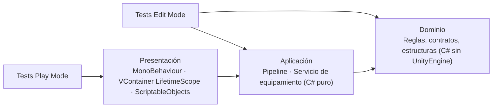

# 01 — Arquitectura: reglas, capas y estructura

> La arquitectura implementada es la **declarada en el resumen ejecutivo del TP1**:
> ISP + Observer (P1), pipeline de comandos asíncrono (P2) y DI con VContainer + ScriptableObjects (P3).
> Este documento explica cómo se materializa en assemblies y qué reglas la sostienen.

## 1. Regla de dependencia



| Capa | Responsabilidad | Puede depender de | Testeable sin escena |
| --- | --- | --- | --- |
| **Dominio** | Contratos, reglas, invariantes, cálculo puro | Nada externo | Sí (Edit Mode) |
| **Aplicación** | Casos de uso con estado: pipeline de comandos, servicio de equipamiento | Dominio | Sí (Edit Mode) |
| **Presentación** | Input, animación, assets, composición con VContainer | Aplicación + Dominio | Solo con Play Mode |

**Regla dura:** ninguna referencia va "hacia arriba". El dominio no sabe que existe Unity, ni que
existe una vista, ni que existe un contenedor de DI.

## 2. Cómo se hace cumplir (asmdef)

| Assembly | `noEngineReferences` | Referencias | Contenido |
| --- | --- | --- | --- |
| `VoidHex.P1.Domain` | `true` | — | `HexCoordinates`, `HexCell`, `GridModel`, `Pathfinder`, contratos ISP |
| `VoidHex.P1.Unity` | `false` | `P1.Domain` | `GridPresenter`, `GridBootstrap` |
| `VoidHex.P2.Domain` | `true` | — | `ShipModel`, `ICommand`, comandos, `CommandValidation`, `ICommandPresentation` |
| `VoidHex.P2.Application` | `true` | `P2.Domain` | `CommandProcessor`, `CommandOutcome`, `TurnPhase` |
| `VoidHex.P2.Unity` | `false` | `P2.Domain`, `P2.Application` | `ShipView`, `TurnDemoDriver` |
| `VoidHex.P3.Domain` | `true` | — | `ModuleDefinition`, `Loadout`, `ShipStatsCalculator`, `IEquipmentService` |
| `VoidHex.P3.Application` | `true` | `P3.Domain` | `EquipmentService`, `ShipConfig` |
| `VoidHex.P3.Unity` | `false` | `P3.Domain`, `P3.Application`, `VContainer` | Assets SO, `EquipmentLifetimeScope`, `LoadoutDemo` |
| `VoidHex.Pn.Tests.EditMode` | `false` | dominio + aplicación + test runners | Unitarios e integración de adaptadores |
| `VoidHex.P2.Tests.PlayMode` | `false` | P2 Unity + dominio + aplicación | Ciclo de vida de Unity |
| `VoidHex.Prototypes.Editor` | `false` | P1/P2/P3 Unity + `VContainer` | Generador de escenas y assets |

Dominio puro:

```json
{
  "name": "VoidHex.P2.Domain",
  "rootNamespace": "VoidHex.P2.Domain",
  "references": [],
  "includePlatforms": [],
  "allowUnsafeCode": false,
  "overrideReferences": false,
  "precompiledReferences": [],
  "autoReferenced": false,
  "defineConstraints": [],
  "versionDefines": [],
  "noEngineReferences": true
}
```

Tests:

```json
{
  "name": "VoidHex.P2.Tests.EditMode",
  "rootNamespace": "VoidHex.P2.Tests",
  "references": [
    "VoidHex.P2.Domain",
    "VoidHex.P2.Application",
    "UnityEngine.TestRunner",
    "UnityEditor.TestRunner"
  ],
  "includePlatforms": ["Editor"],
  "precompiledReferences": ["nunit.framework.dll"],
  "autoReferenced": false,
  "defineConstraints": ["UNITY_INCLUDE_TESTS"]
}
```

**Por qué importa en la defensa:** la promesa "el dominio es independiente de Unity" no se demuestra
con una frase, se demuestra escribiendo `using UnityEngine;` en el dominio y mostrando que **no compila**.

### Referencias transitivas

Un assembly que **usa** un tipo cuya clase base vive en otro assembly necesita declararlo: el
compilador no infiere la jerarquía de tipos externos. Por eso `VoidHex.Prototypes.Editor` referencia
`VContainer` explícitamente (usa `EquipmentLifetimeScope`, que hereda de `LifetimeScope`); sin esa
referencia aparecen `CS0012` y `CS0311`. Regla práctica: *si agregás un `AddComponent<T>` en un
assembly nuevo, revisá la cadena de herencia de `T`*.

## 3. Estructura de carpetas

```text
Assets/Prototypes/
  P1_GridState/
    Runtime/Domain/     → VoidHex.P1.Domain.asmdef (ISP + Observer + sustrato hexagonal)
    Runtime/Unity/      → VoidHex.P1.Unity.asmdef
    Tests/EditMode/     → VoidHex.P1.Tests.EditMode.asmdef
    Scenes/             → generadas por PrototypeSceneBuilder
    README.md
  P2_CommandPipeline/
    Runtime/Domain/ · Runtime/Application/ · Runtime/Unity/
    Tests/EditMode/ · Tests/PlayMode/ · Scenes/
    README.md
  P3_Loadout/
    Runtime/Domain/ · Runtime/Application/ · Runtime/Unity/
    Tests/EditMode/ · Scenes/ · Assets/ (módulos y catálogo SO)
    README.md
  Editor/               → VoidHex.Prototypes.Editor.asmdef (generador de escenas)
```

No hay carpeta compartida entre prototipos. Es deliberado: la independencia que exige la consigna
(§3.1) vale más que ahorrar ~40 líneas de `HexCoordinates` duplicadas.

## 4. Qué va en cada capa (por prototipo)

| Prototipo | Dominio | Aplicación | Presentación |
| --- | --- | --- | --- |
| **P1 GridState** | `HexCoordinates`, `HexCell`, `GridModel`, `Pathfinder`, `IGridQueryService`, `IGridStatePublisher` | — (una consulta, sin caso de uso con estado) | `GridPresenter`, `GridBootstrap` |
| **P2 CommandPipeline** | `ShipModel`, `ICommand`, `Move/Attack/ShieldCommand`, `CommandValidation`, `ICommandPresentation` | `CommandProcessor` (pipeline + cola), `CommandOutcome`, `TurnPhase` | `ShipView` (adaptador async), `TurnDemoDriver` |
| **P3 Loadout** | `ModuleDefinition`, `Loadout`, `ShipStatsCalculator`, `IModuleCatalog`, `IEquipmentService` | `EquipmentService`, `ShipConfig` | `ShipModuleAsset`, `ModuleCatalogAsset`, `EquipmentLifetimeScope`, `LoadoutDemo` |

Reglas particulares:

- **P1:** las mutaciones de `GridModel` **no** están en las interfaces. Esa es la garantía de ISP.
- **P2:** `ICommandPresentation` es un puerto de salida del dominio; la asincronía vive ahí, no en la regla.
- **P3:** VContainer se usa solo en la capa de presentación (composition root). El servicio no
  conoce el contenedor: recibe `IModuleCatalog` y `ShipConfig` por constructor.

### Disciplina de la capa de presentación

La presentación es la **única** capa con `MonoBehaviour`, y se usa solo donde hace falta el ciclo
de vida del motor: dibujar, escuchar eventos y animar. Las decisiones de juego nunca viven ahí.

| Regla | Cómo se sostiene | Verificación |
| --- | --- | --- |
| Un `MonoBehaviour` solo en `Runtime/Unity/` o `Editor/` | Revisión de estructura + chequeo automático | `check_layers.py` R1 |
| Dominio y aplicación sin tipos de Unity | `noEngineReferences: true` en el asmdef | compilador + `check_layers.py` R2 |
| La vista no decide: pide y muestra | Consume contratos (`IGridQueryService`, `GameSession`); recibe resultados con motivo | tests de dominio + `TurnScreen`/`GameLoopScreen` como consumidores |
| Sin reglas duplicadas en la vista | Los valores se leen del dominio (`session.AttackRange`), no se repiten como literales | revisión |
| Destrucción de objetos vía `SafeObjects.Destroy` | `Object.Destroy` no funciona en edit mode: no destruye y ensucia la consola | `check_layers.py` R3 |

El caso que motivó R3: el mismo camino de código (poblar el tablero) corre en Play Mode desde una
escena y en edit mode desde el generador de escenas. `Object.Destroy` avisa
`Destroy may not be called from edit mode` y **deja el objeto vivo**, así que los props se
duplicaban. `SafeObjects.Destroy` elige `Destroy` o `DestroyImmediate` según `Application.isPlaying`.

## 5. Ajustes respecto del diseño del TP1

| TP1 (documento) | TP2 (implementación) | Motivo |
| --- | --- | --- |
| El informe desarrolla grilla/A* como **Problema 1** | P1 implementa **ISP + Observer** (el desafío del resumen ejecutivo); la grilla es el sustrato | El TP1 defendido declara la exposición de estado como desafío; el TP2 implementa lo declarado |
| `ICommand` con `UniTask` | `ICommand` sincrónico + `ICommandPresentation` con `Task` | El PDF declara "UniTask / Task"; `Task` no agrega dependencias de red y deja un único punto de sustitución |
| Undo/Redo | Fuera de alcance | El PDF lo menciona como capacidad habilitada, no como requisito; se excluye justificadamente |
| FSM de turnos con estados por acción | Tres fases (`PlayerTurn`, `Executing`, `EnemyTurn`) | El PDF descarta la FSM monolítica |
| `ShipStatsCalculator` recibe `ShipModuleSO` | El dominio recibe `ModuleDefinition`; el SO es adaptador | Mantiene el dominio libre de `UnityEngine` sin perder el flujo data-driven |
| Slots con validación de tipo | Un slot por tipo | La incompatibilidad se vuelve imposible por construcción |
| Texto de UI en los contratos | Eventos y resultados con motivo | La vista explica el rechazo; el test verifica el motivo, no un string |

Ningún ajuste cambia **qué** resuelve cada prototipo: cambian **cómo** se respeta la regla de
dependencia y el alcance declarado. Se documentan porque la consigna (§4.1) los pide explícitamente.

## 6. Convenciones de contratos

| Tema | Regla | Ejemplo |
| --- | --- | --- |
| Entradas inválidas esperables | Resultado con motivo | `CommandValidation.Rejected(NotEnoughActionPoints, 3, 1)` |
| Precondición rota (bug) | Excepción | `ArgumentNullException` si el catálogo es `null` |
| Ausencia | `TryGet…(out …)` / resultado | `loadout.TryGetModule(SlotType.Weapon, out var m)` |
| Mutabilidad | Estado inmutable + `With…` | `shipModel.WithActionPoints(4)` |
| Colecciones | `IReadOnlyList<T>` hacia afuera | `PathResult.Path`, `HexCoordinates.Directions` |
| Quién muta | Un único dueño por estado | `GridModel` (mapa), `CommandProcessor` (nave) |
| Aleatoriedad | Semilla inyectada | Ningún componente usa `Random` |
| Tiempo | Prohibido en dominio | Sin `Time.deltaTime` fuera de Presentación |
| Cadenas como datos | `string.Empty`, nunca `null` | `GrantedAbilityId` |

## 7. Dependencias externas

| Paquete | Versión | Dónde | Por qué |
| --- | --- | --- | --- |
| `jp.hadashikick.vcontainer` | 1.19.0 (OpenUPM) | Solo P3 Unity | Declarado en el TP1 como solución de DI (desafío 3) |
| `com.unity.test-framework` | 1.7.0 | Tests | Edit Mode y Play Mode |

UniTask **no** se agrega: se usa `Task` (BCL), declarado como alternativa en el PDF, para que la
suite sea reproducible en una máquina limpia sin descargas adicionales.

## 8. Nomenclatura de tests

`Método_Escenario_ResultadoEsperado`, por ejemplo:

- `SetCell_WithSameValue_DoesNotRaiseChange`
- `Submit_AppliesLogicBeforeTheAnimationCompletes`
- `TryEquip_ReplacingModule_DoesNotDoubleCount`

Cada test sigue Arrange–Act–Assert y verifica un solo comportamiento conceptual.
