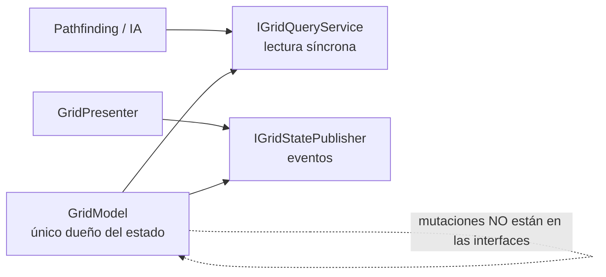
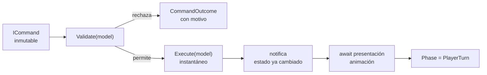
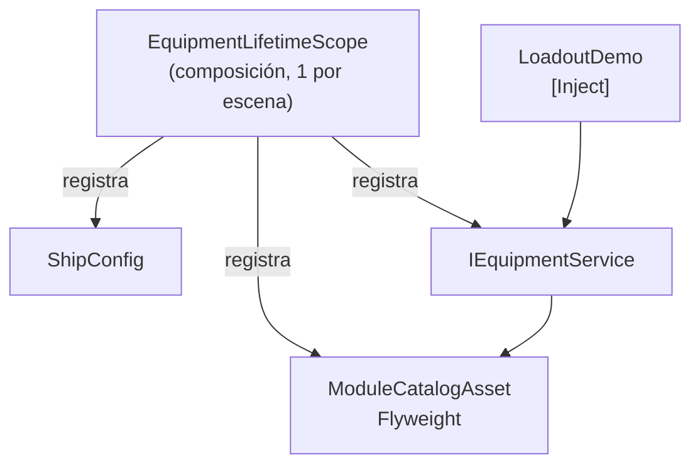

# 07 — Presentación TP2 (guion de slides)

> **Deck generado:** [`presentacion/TP2-VoidHex-Tactics.pptx`](./presentacion/TP2-VoidHex-Tactics.pptx)
> — 21 slides 16:9 con diagramas nativos y notas del orador. Los diagramas también están como PNG en
> [`presentacion/assets/`](./presentacion/assets). Para regenerar: `python tools/ppt/build_deck.py`.
> **El generador (`tools/ppt/build_deck.py`) define el layout real del deck**; este documento es la
> referencia de contenido y guion. Si cambia un caso, se actualizan los dos.
>
> **Para qué sirve este archivo:** es el contenido listo para PowerPoint.
> Cada bloque = una slide. Copiá el *título*, los *bullets* y el *visual*; las **notas del orador**
> van en el recuadro de notas, no en la slide.
> **Regla que ordena todo:** la devolución del TP1 dijo *"los problemas y soluciones están bien…
> en las slides no dejás las cosas muy claras"*. Por eso cada slide sostiene **una sola afirmación**
> con **una evidencia visible**. Si una slide necesita que la expliques para entenderse, está mal.

---

## 0. Reglas de diseño (derivadas del feedback)

| Feedback del TP1 | Regla aplicada | Antes ❌ | Después ✅ |
| --- | --- | --- | --- |
| "En las slides no dejás las cosas muy claras" | Título = afirmación, no etiqueta | "Problema 1: Grilla" | "La vista no puede tocar el mapa: no compila" |
| "Ayudó mucho tu defensa oral" | La slide se entiende **sin vos** | Bullets abstractos | Número, test o diagrama concreto |
| "Bien los problemas y soluciones" | Mantener el eje problema → solución | — | Cada bloque arranca con el problema declarado |
| (implícito) | Nada de muros de texto | 12 bullets por slide | ≤ 6 líneas, ≤ 12 palabras por línea |
| (implícito) | Una evidencia por slide | "es escalable" | Nombre del test en verde |

**Paleta y formato sugeridos:** fondo oscuro, una tipografía, tamaño mínimo 20 pt, código en
monoespaciada con máximo 8 líneas. Nada de animaciones.

---

## 1. Mapa de tiempos (20 min)

| Slides | Bloque | Minutos |
| --- | --- | --- |
| 1–3 | Marco: qué entrego y cómo se sostiene | 2:00 |
| 4–7 | **P1** ISP + Observer | 5:00 |
| 8–11 | **P2** Pipeline async | 5:30 |
| 12–14 | **P3** DI + Data-driven | 4:00 |
| 15–17 | Tests, exclusiones y ajustes | 2:30 |
| 18 | Cierre | 1:00 |

Quedan ~0:30 de colchón. Si te pasás, recortá la slide 7 y la 17 (no las de evidencia).

---

## 2. Slide por slide

### Slide 1 — Portada

**Título:** TP2 · Implementación y tests

**Subtítulo:** Void Hex Tactics — tres decisiones de arquitectura, verificadas

**Pie:**

```text
Programación de Videojuegos III · 2026
Matias Andres Fahler
Unity 6000.5.9f1 · tag tp2
```

**Visual:** las tres carpetas del repo (`P1_GridState`, `P2_CommandPipeline`, `P3_Loadout`) como
tres bloques, sin adornos.

**Notas del orador (15 s):** "No voy a mostrar un juego. Voy a mostrar tres problemas técnicos del
TP1, la solución que declaré para cada uno, y la evidencia de que funciona."

---

### Slide 2 — "No entrego un juego: entrego tres decisiones verificables"

**Tabla (única de la slide):**

| Desafío del TP1 | Solución declarada | Dónde vive |
| --- | --- | --- |
| Exponer el mapa sin God Object ni polling | ISP + Observer | `P1_GridState` |
| Alternar PA con animaciones async | Pipeline `ICommand` + async | `P2_CommandPipeline` |
| Servicios sin singletons + módulos MK I–III | VContainer + ScriptableObjects | `P3_Loadout` |

**Visual:** una fila por prototipo; nada más.

**Notas del orador (45 s):** "Estos tres desafíos son los que declaré en el TP1. El TP2 no cambia el
diagnóstico: cambia que ahora está implementado y testeado. Cada prototipo es una carpeta
independiente, con su escena y su suite."

**Pregunta que invita:** *"¿por qué no un juego completo?"* → Slide 2 responde: la consigna pide 3
pruebas de concepto pulidas; el contenido no demuestra ninguna propiedad de diseño.

---

### Slide 3 — "La arquitectura la impone el compilador, no la disciplina"

**Contenido:**

- Capas: **Presentación → Aplicación → Dominio**
- El dominio declara `"noEngineReferences": true`
- Si alguien escribe `using UnityEngine;` en el dominio, **el proyecto no compila**

**Visual:** diagrama de capas (3 cajas con flechas hacia abajo) + un recorte de 4 líneas del
`.asmdef`:

```json
"references": [],
"noEngineReferences": true
```

**Notas del orador (60 s):** "Podría prometerles que el dominio es independiente de Unity. No lo voy
a prometer: lo voy a demostrar borrando una línea y mostrando que no compila. Esta regla es la base
de los tres prototipos."

**Demo asociada:** D2 (romper el dominio en vivo) — solo si hay tiempo; si no, mostrar la captura
del error ya tomada.

---

### Slide 4 — P1 · El problema

**Título:** "Exponer el mapa sin God Object ni polling en `Update()`"

**Dos columnas:**

| Lo que NO quiero | Por qué |
| --- | --- |
| Un `GridManager` que sabe todo | God Object: nadie sabe quién muta el estado |
| `Update()` consultando el mapa | CPU por frame y acoplamiento al motor |
| Event Bus global | Dependencias ocultas, imposible de depurar |

**Notas del orador (45 s):** "El mapa lo necesitan tres consumidores con necesidades distintas: la IA
lee, los comandos validan, la UI dibuja. Si les doy el mismo objeto, la UI puede cambiar reglas y la
IA queda escuchando eventos visuales."

---

### Slide 5 — P1 · La solución: dos contratos, ningún consumidor puede hacer lo del otro

**Visual (diagrama):**



**Bullets (3):**

- La IA y el pathfinding dependen de `IGridQueryService`: **no tienen forma de mutar**
- La vista depende de `IGridStatePublisher`: **no tiene forma de alterar reglas**
- Solo `GridModel` muta, y esos métodos **no están en ningún contrato**

**Notas del orador (60 s):** "Esto no es una convención de estilo: es el tipo del constructor. El
`Pathfinder` recibe `IGridQueryService`. Aunque quisiera, no puede escribir el mapa."

---

### Slide 6 — P1 · La evidencia: reactivo de verdad

**Números grandes (los protagonistas):**

| Escenario | Eventos emitidos |
| --- | --- |
| Celda cambia de verdad | **1** |
| Se escribe el mismo valor | **0** |
| Mapa 12×12 con 4 obstáculos | **4 redibujos** |

**Caso real de la escena:** asteroides y cristales del Kenney Space Kit; ruta de **21 celdas**
con costo **20**; el contador de eventos queda exactamente en 4, la cantidad de obstáculos.

**Tests en verde (3 nombres, sin código):**

- `IGridStatePublisher_ExposesOnlyEvents`
- `IGridQueryService_ExposesNoMutatingMembers`
- `SetCell_WithSameValue_DoesNotRaiseChange`

**Notas del orador (60 s):** "Los dos primeros no prueban comportamiento: prueban **forma**. Usan
reflexión para verificar que el contrato de publicación solo tenga eventos y que el de lectura no
tenga mutaciones. Si mañana alguien agrega un `SetCell` a la interfaz de lectura, el test se pone
rojo antes de que llegue a la UI."

**Pregunta que invita:** *"¿qué error detectaría?"* → "Que el evento se dispare sin cambio real, que
es polling disfrazado de reactividad."

---

### Slide 7 — P1 · Lo que dejé afuera (y por qué)

**Título:** "El A* es el sustrato, no la tesis"

**Bullets:**

- El informe largo del TP1 desarrolla grilla y pathfinding; el **desafío declarado** es la exposición del estado
- La geometría y el A* existen para tener algo real que consultar
- Excluido: mapas 3D, niebla de guerra, unidades como bloqueos, optimización de mapas grandes
- **Event Bus global: descartado**, no es una omisión

**Notas del orador (45 s):** "Si alguien pregunta por qué no hay niebla de guerra: porque es un
sistema de conocimiento, no de exposición de estado. Lo dejé afuera con una ruta de extensión
documentada, no porque no supiera cómo hacerlo."

> **Nota interna:** esta slide es la que corrige la ambigüedad del TP1. No la saltees: explica por
> qué el prototipo implementa ISP y no "la matemática hexagonal".

---

### Slide 8 — P2 · El problema

**Título:** "Mover → Atacar → Mover, sin que la animación decida las reglas"

**Dos columnas:**

| Lo que NO quiero | Por qué |
| --- | --- |
| `TurnManager` con corrutinas | `WaitForSeconds` mete el tiempo del arte dentro de la regla |
| FSM con un estado por acción | Explota en combinaciones al agregar módulos |
| Un comando por cada orden posible | Toca el controlador central cada vez |

**Notas del orador (40 s):** "El jugador puede intercalar acciones. La pregunta difícil no es
'¿puede moverse?', es **cuándo** se aplica el efecto: antes o después de la animación."

---

### Slide 9 — P2 · La solución: la regla se aplica al instante, la animación espera después

**Visual (diagrama de flujo):**



**Bullets (3):**

- `CommandProcessor` es el **único dueño** del estado
- Una cola serializa comandos: dos envíos seguidos **no se intercalan**
- Solo tres fases: `PlayerTurn`, `Executing`, `EnemyTurn`

**Notas del orador (70 s):** "Mirá el orden: cuando el pipeline vuelve de `Execute`, el estado ya
cambió. La animación arranca después y no puede condicionar la regla. Si el jugador pulsa dos veces,
el segundo comando espera en la cola; no hay estado a medio aplicar."

---

### Slide 10 — P2 · La evidencia: el estado cambia antes de que termine la animación

**Test protagonista (una línea, sin código):**

> `Submit_AppliesLogicBeforeTheAnimationCompletes`

**Tres aserciones, en texto grande:**

1. Posición y PA **ya cambiaron**
2. `Phase == Executing`
3. El `Task` de la animación **sigue pendiente**

**Segundo test:** `Submit_SecondCommand_QueuesUntilTheFirstAnimationCompletes`

**Corrida real de la escena:** mover (2,0) 2 PA → atacar 2 PA → mover (3,0) 1 PA.
Resultado: **PA 6 → 1**, **hull enemigo 6 → 3**.

**Notas del orador (60 s):** "Este es el test que demuestra el desacoplamiento temporal. Si alguien
implementa la lógica esperando la animación, este test falla: la posición no habría cambiado."

**Pregunta que invita:** *"¿qué error detectaría?"* → acoplar la regla al tiempo de la animación, o
intercalar dos comandos y corromper el estado.

---

### Slide 11 — P2 · Extensible sin tocar el pipeline

**Título:** "Agregar una habilidad es crear una clase, no modificar el sistema"

**Visual:** tres comandos (`MoveCommand`, `AttackCommand`, `ShieldCommand`) apuntando a la misma
interfaz `ICommand`. Un recuadro aparte: `TractorBeamCommand` marcado como **"en vivo"**.

**Bullets:**

- `ShieldCommand` ya existe (2 PA, +4 escudo): **cero cambios** en `CommandProcessor`
- Test que lo respalda: `Submit_NewCommandVariant_RequiresNoPipelineChange`
- Diferido: Undo/Redo (el TP1 lo menciona como capacidad habilitada, no como requisito)

**Notas del orador (50 s):** "Si quieren, agrego un `TractorBeamCommand` ahora mismo: valida PA,
mueve la nave enemiga, y el pipeline no se entera."

**Demo asociada:** D4.

---

### Slide 12 — P3 · El problema

**Título:** "Sin `GameManager.Instance` y sin Service Locator"

| Lo que NO quiero | Por qué |
| --- | --- |
| `GameManager.Instance` | Dependencias ocultas y estado global mutable |
| Service Locator | Mismo problema con otro nombre: la clase pide, no recibe |
| Stats calculadas dentro del `ScriptableObject` | El cálculo queda atado al motor y no se puede testear |

**Notas del orador (40 s):** "El síntoma es fácil de ver: si para testear tengo que abrir una escena,
la dependencia está mal puesta."

---

### Slide 13 — P3 · La solución: dependencias por constructor, datos como assets

**Visual (diagrama):**



**Bullets:**

- `EquipmentService` recibe `IModuleCatalog` por constructor: **no busca nada**
- El `ScriptableObject` es **adaptador**, no modelo: el dominio recibe `ModuleDefinition`
- Un asset por módulo = **una instancia compartida** (Flyweight)

**Notas del orador (60 s):** "El contenedor vive en la capa de presentación. El servicio ni sabe que
existe VContainer: recibe una interfaz por constructor. Eso es lo que permite testearlo sin escena."

---

### Slide 14 — P3 · La evidencia: testeable sin Unity y ampliable sin recompilar

**Dos columnas:**

| DIP (mock inyectado) | Data-driven (sin código) |
| --- | --- |
| `EquipmentService_WithInjectedFakeCatalog_ResolvesModulesById` | `laser-mk1` → `laser-mk2` reemplaza en el slot |
| El fake **cuenta** las consultas al catálogo | `laser-mk3` existe como asset, no como clase |
| Corre en Edit Mode, sin escena | Stats reales: **PA 6 · escudos 5 · movimiento 4** |

**Bullets (2):**

- `TryEquip_ReplacingModule_DoesNotDoubleCount` — el reemplazo MK I → MK II no suma dos veces
- Un slot por tipo ⇒ el estado inválido "módulo en slot incompatible" **no puede existir**

**Notas del orador (60 s):** "La primera columna demuestra DIP: si mañana el catálogo viene de un
servidor, el servicio no cambia. La segunda demuestra que el diseñador agrega contenido sin tocar
C#."

**Demo asociada:** D5 y D6.

---

### Slide 15 — "Cada comportamiento tiene un test y un defecto declarado"

**Visual:** una tabla de 3 filas (una por prototipo), recortada de `docs/04-trazabilidad.md`.

| Comportamiento | Test | Error que detectaría |
| --- | --- | --- |
| El evento solo se emite si hay mutación real | `SetCell_WithSameValue_DoesNotRaiseChange` | Polling disfrazado de reactividad |
| El estado cambia antes de la animación | `Submit_AppliesLogicBeforeTheAnimationCompletes` | Regla acoplada al tiempo del arte |
| Reemplazar un módulo no duplica stats | `TryEquip_ReplacingModule_DoesNotDoubleCount` | Sumar el módulo viejo y el nuevo |

**Bullets (1):** 81 tests: 80 en Edit Mode, 1 en Play Mode (el único que depende del ciclo de vida de Unity).
Reparto Edit Mode: P1 5 · P2 7 · P3 9 · bucle jugable 59.

**Notas del orador (50 s):** "La consigna pregunta qué error detectaría cada test. No tengo un test
por método: tengo un test por regla, y cada uno responde esa pregunta. El único Play Mode es el de P2,
porque es el único donde importa que Unity invoque al adaptador."

> **Números ya verificados:** 80 en Edit Mode y 1 en Play Mode (81), corridos el 28/10, antes de
> crear el tag. Si pedís la captura, está en `Logs/tests-editmode.json`.

---

### Slide 16 — "Esto es lo que dejé afuera, y por qué"

**Tabla (5 filas máximo):**

| Excluido | Justificación | Ruta de extensión |
| --- | --- | --- |
| Undo / Redo | Capacidad habilitada, no requisito del prototipo | Historial de estados en el pipeline |
| IA enemiga | El desafío es el flujo de comandos, no la búsqueda de jugadas | El pipeline ya acepta cualquier `ICommand` |
| Animación con clips | Los modelos se mueven por transform, sin `Animator` | `Animator` sobre el modelo actual |
| Modificadores multiplicativos | Ningún módulo del alcance los usa | `StatModifier` con operación |
| Mapas 3D / niebla de guerra | Otro sistema, no exposición de estado | Capa sobre `IGridQueryService` |

**Notas del orador (45 s):** "La consigna dice que excluir un caso necesita justificación. Estas no
son las cosas que no llegué a hacer: son las que decidí no hacer, y cada una tiene por dónde crecer."

> **Aclaración necesaria:** sí hay arte 3D real (modelos del Kenney Space Kit). Lo excluido es la
> **animación con clips**, no el arte. No digas "sin arte": es falso y se nota en la escena.

---

### Slide 17 — "Qué cambié, y qué descubrí al implementar"

**Tabla superior (3 filas), los cambios del TP1:**

| TP1 | TP2 | Motivo |
| --- | --- | --- |
| `ExecuteAsync` devuelve `UniTask` | `ICommand` sincrónico + `Task` en el puerto de vista | El PDF admite *UniTask / Task*; sustitución en una sola interfaz |
| `ShipModuleSO` entra al cálculo | El dominio recibe `ModuleDefinition` | Mantener el dominio libre de `UnityEngine` |
| FSM con estados por acción | Tres fases | Evitar la explosión de combinaciones |

**Hallazgos reales (la parte que pide §4.1: "qué descubriste al implementar"):**

| Qué parecía | Qué era |
| --- | --- |
| Un bug de arquitectura en P2 | El FBX de Kenney venía con el pivote descentrado: la nave se dibujaba al lado de su anillo |
| Un fallo de layout | `transform.Find` por ruta lanzó `NullReferenceException` y cortó el panel: la fábrica debe devolver tipos, no nombres |
| `[Inject]` no se ejecutaba | Llegaba **después** de `Start`: la nave 3D nunca se construía. Se resuelve con un evento `Ready`, no con un orden implícito |
| Los botones no respondían | Con el Input System nuevo, `StandaloneInputModule` es inerte: hace falta `InputSystemUIInputModule` |

**Bonus si preguntan por los tests:** una aserción propia estaba mal (la ruta costaba 3, no 4). Se
detectó ejecutando la lógica pura fuera del editor. Los tests también pueden estar equivocados.

**Notas del orador (45 s):** "Los cuatro cambios están en `docs/01 §5`; los cuatro hallazgos, en el
código. El del pivote enseña algo: agoté hipótesis de arquitectura antes de mirar el asset."

---

### Slide 18 — Cierre

**Tres líneas, nada más:**

1. Tres problemas del TP1, tres soluciones declaradas, tres suites que las verifican.
2. Las propiedades de diseño se demuestran: ISP por reflexión, OCP con un comando nuevo, DIP con un fake.
3. Lo que no está, está afuera por decisión y con ruta de extensión.

**Visual:** los tres nombres de carpeta + "81 tests verdes".

**Notas del orador (20 s):** "Con más tiempo, el siguiente paso sería Undo/Redo, porque el pipeline ya
lo habilita. Pero eso es otro prototipo, no una deuda escondida."

---

## 3. Slides de respaldo (no se muestran, se usan si preguntan)

### B1 — Mutation demo

| Prototipo | Línea que rompo | Test que se pone rojo |
| --- | --- | --- |
| P1 | Emitir el evento aunque el valor no cambie | `SetCell_WithSameValue_DoesNotRaiseChange` |
| P2 | Esperar la animación antes de mutar el estado | `Submit_AppliesLogicBeforeTheAnimationCompletes` |
| P3 | Sumar el módulo anterior y el nuevo | `TryEquip_ReplacingModule_DoesNotDoubleCount` |

**Cómo se hace:** `git stash` → editar una línea → correr el test → mostrar rojo → `git checkout .`

### B2 — Contratos y decisiones de código

| Pregunta | Respuesta |
| --- | --- |
| ¿Cuándo usás excepciones? | Solo precondiciones rotas (catálogo `null`). Un estado inválido de juego es un resultado con motivo |
| ¿Por qué no `null` para ausencia? | `TryGetModule(out …)` obliga a manejarla; `null` explota lejos del origen |
| ¿Quién puede mutar? | `GridModel` el mapa, `CommandProcessor` la nave, `EquipmentService` el loadout. Nadie más |
| ¿Por qué estructuras inmutables? | Permiten comparar antes/después y razonar sobre undo sin deriva |

### B3 — Cómo se corre (funciona con el editor abierto)

```powershell
# Escenas: se generan solas si faltan, o por menú
unity command --project-path . menu --path "VoidHex/Build Prototype Scenes"

# Suite completa
unity command --project-path . run_tests --mode EditMode
unity command --project-path . run_tests --mode PlayMode --async_tests

# Evidencia visual
unity command --project-path . capture_game_view --source screen --save_path captura.png
```

Unity 6000.5.9f1 trae el paquete `com.unity.pipeline`: el editor se controla por CLI mientras está
abierto. El `-batchmode` clásico también existe, pero exige el proyecto sin lock (editor cerrado).

En el editor: `VoidHex → Build Prototype Scenes`, luego `Window → General → Test Runner`.

**Verificadores propios:** `tools/verify/check_asmdef_refs.py` (referencias), `check_scenes.py`
(integridad de escenas) y `tools/audit` (lógica pura sin Unity).

---

## 4. Checklist de ensayo

- [ ] Los números de tests (81 = 80 + 1) están respaldados por `Logs/tests-*.json`.
- [ ] Verificar que cada slide se entienda **sin** leer las notas del orador.
- [ ] Un solo mensaje por slide: si hay dos, se parte o se recorta.
- [ ] Las 6 demos ensayadas dos veces, con plan B (test en lugar de escena).
- [ ] Cronometrado dos veces ≤ 20 min.
- [ ] Practicar la transición de la slide 7 (la que corrige el malentendido del TP1).
- [ ] Tener a mano `docs/04-trazabilidad.md` para responder "¿qué error detectaría?".
- [ ] Fuente ≥ 20 pt y ningún diagrama ilegible desde el fondo del aula.
- [ ] Nada de código de más de 8 líneas en pantalla.

## 5. Lo que NO va en la presentación

| Tentación | Por qué no |
| --- | --- |
| Mostrar el GDD completo | Ya está en el repo; la defensa es sobre el código y los tests |
| Diagramas de 10 cajas | El TP1 ya perdió claridad por esto |
| Explicar SOLID en abstracto | Se demuestra con ISP, OCP y DIP aplicados, no con definiciones |
| Listar todos los tests | Tres ejemplos con su defecto dicen más que veinte nombres |
| Prometer lo que no está | La consigna evalúa el alcance, no la ambición |
